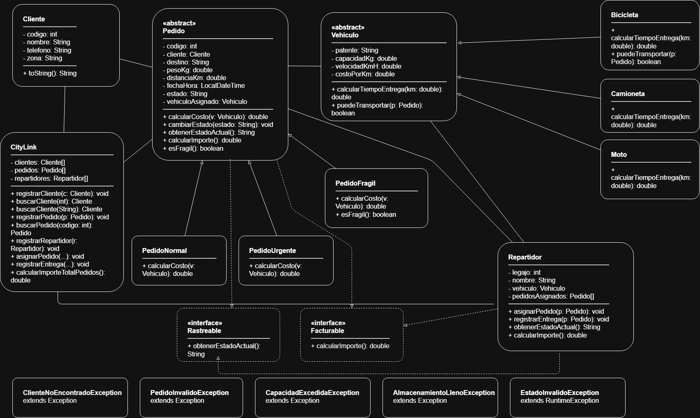

# CityLink — Sistema de Gestión de Repartos

## 1. Descripción del proyecto

CityLink es una aplicación de consola desarrollada en Java para gestionar un servicio de reparto. Permite registrar clientes, repartidores y pedidos, asignar pedidos a vehículos, consultar estados y calcular costos y comisiones.

## 2. Funcionalidades principales

- Registrar y buscar clientes.
- Registrar repartidores y sus vehículos.
- Registrar pedidos normales, urgentes y frágiles.
- Asignar pedidos a repartidores según la capacidad y las restricciones del vehículo.
- Cambiar estados de los pedidos y registrar entregas.
- Consultar el estado de pedidos y repartidores.
- Calcular costos de pedidos y comisiones de repartidores.
- Validar datos y gestionar excepciones.

## 3. Tecnologías utilizadas

- Lenguaje: Java.
- Interfaz: consola.
- Almacenamiento: arreglos estáticos.
- Programación orientada a objetos.

## 4. Estructura del proyecto

- `src/modelo/`: clases del modelo de negocio, pedidos, vehículos, clientes, repartidores e interfaces.
- `src/excepciones/`: excepciones personalizadas.
- `src/app/`: clase principal y ejecución de la aplicación.
- `out/`: archivos compilados.

## 5. Requisitos

- Tener instalado el JDK de Java.
- Ejecutar los comandos desde la carpeta raíz del proyecto.

## 6. Compilación y ejecución

En una terminal de PowerShell, ejecutar:

```powershell
javac -d out src/modelo/*.java src/excepciones/*.java src/app/*.java
```

Luego, iniciar la aplicación con:

```powershell
java -cp out app.Main
```

## 7. Conceptos de programación aplicados

El proyecto utiliza clases abstractas, herencia, interfaces, encapsulamiento, polimorfismo, sobrecarga de métodos, arreglos estáticos y manejo de excepciones.

## 8. Diagrama de clases


El diagrama de clases se adjunta por separado como parte de la documentación del proyecto.

## 9. Uso de herramientas de inteligencia artificial

Se utilizaron herramientas de inteligencia artificial como apoyo para comprender conceptos, revisar código, detectar errores y elaborar documentación. Los resultados de la aplicación fueron comprobados de manera manual con asistencia de la IA para no dejar posibles fallas de lado.

## 10. Integrantes

- López Pochetti Ezequiel Róman
- Scibilia Echegaray Victoria Belén